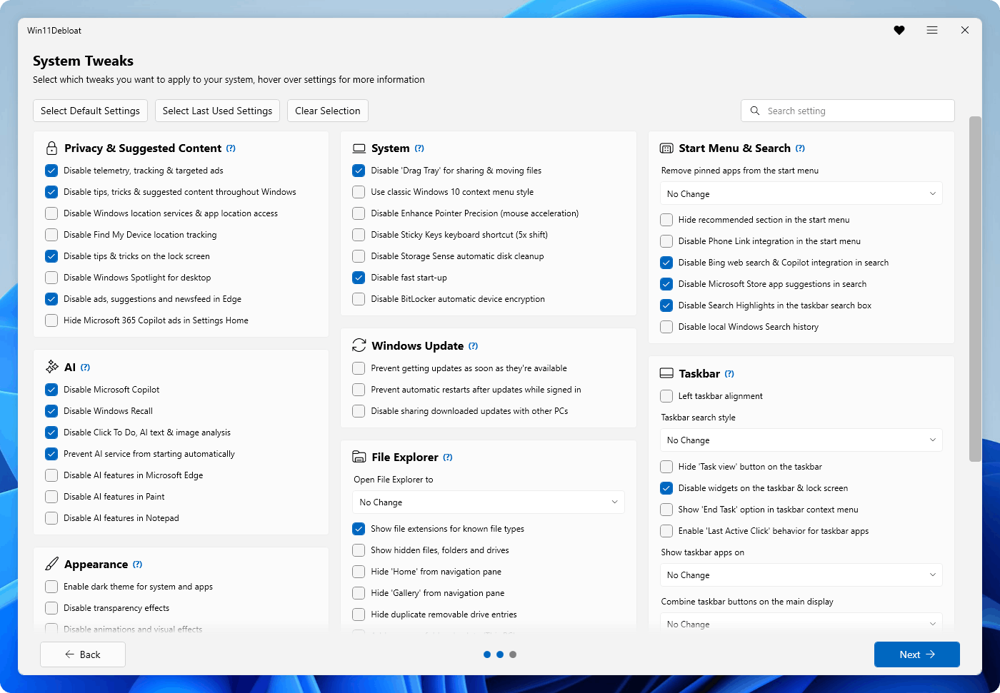
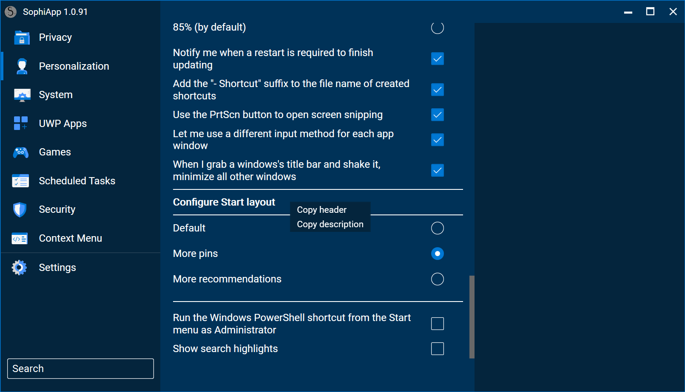
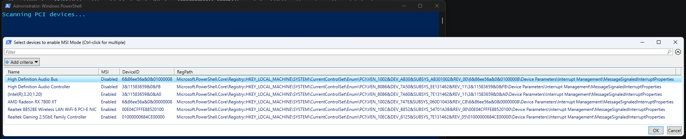
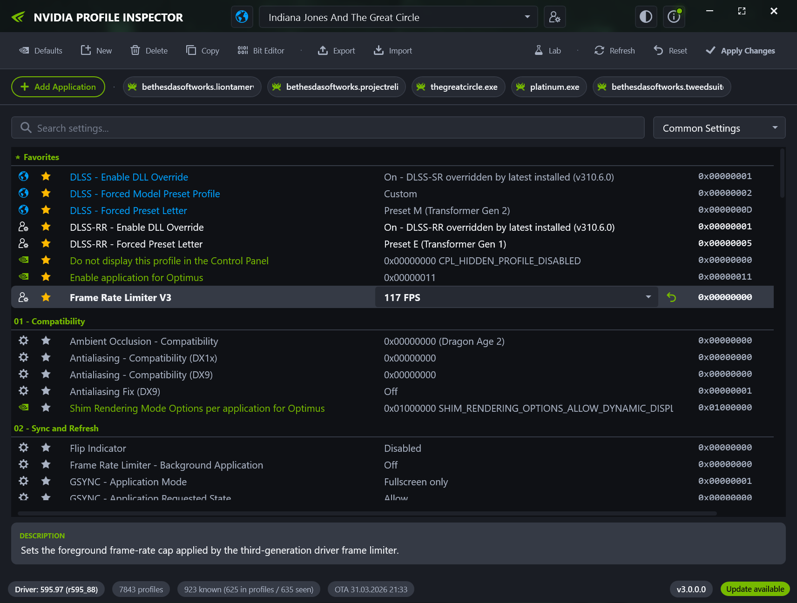
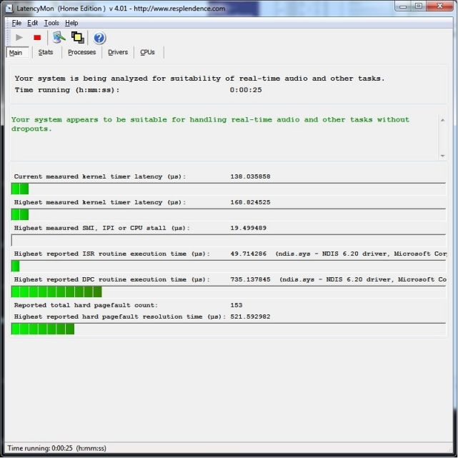
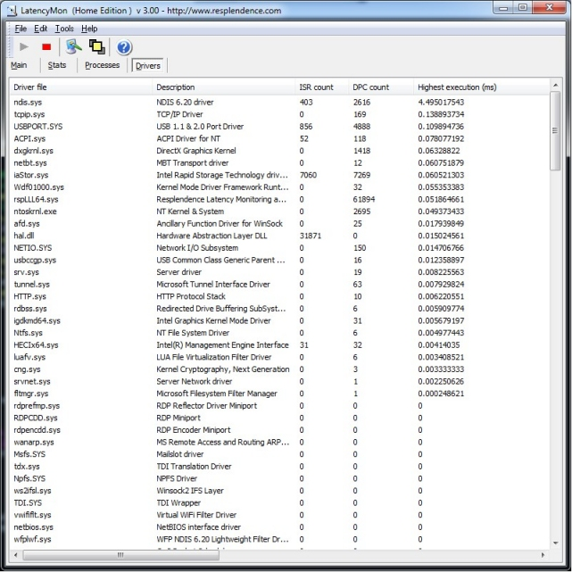
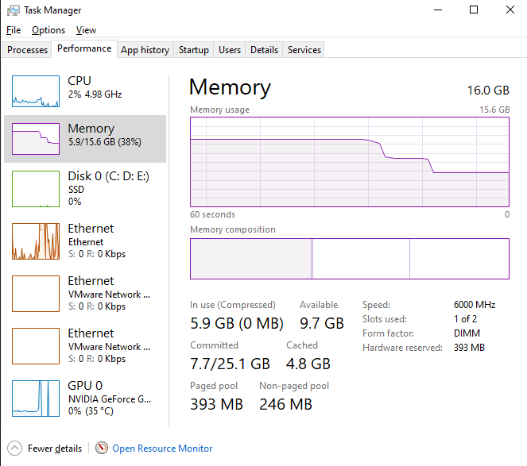

# Cẩm Nang Debloat & Tối Ưu Hóa Windows 10/11 Toàn Diện

> **Tài liệu chuẩn hóa dành cho game thủ Esports, kỹ thuật viên máy tính và anh em đam mê phần cứng: Làm sạch hệ thống, triệt tiêu độ trễ ngắt DPC, khóa cứng phản hồi chuột/bàn phím và tối ưu hóa phần cứng an toàn, đã qua xác thực kỹ thuật.**

---

[](#)
[](#)
[](#)
[](#)

---

## Cảnh Báo Quan Trọng Trước Khi Thao Tác

Tối ưu hóa Windows ở mức độ sâu không phải là "phép thuật", mà là quá trình tinh giản bớt các dịch vụ nền không cần thiết và cấu hình lại cách nhân Windows (NT Kernel) giao tiếp với phần cứng. Một thao tác vội vàng có thể làm hỏng tính năng bạn cần hàng ngày. Trước khi bắt đầu, hãy nắm rõ các nguyên tắc cốt lõi:

1. **Bắt buộc tạo điểm khôi phục (System Restore Point):** Đừng bao giờ bỏ qua bước này. Nếu có sự cố, bạn chỉ mất 2 phút để quay về trạng thái ban đầu mà không mất dữ liệu.
2. **Không chạy các script từ xa khi chưa kiểm tra code:** Thói quen copy các lệnh dạng `irm ... | iex` chạy thẳng vào PowerShell có rủi ro bảo mật rất cao nếu repository của tác giả bị xâm nhập. Hãy kiểm tra nội dung script hoặc chạy các công cụ mã nguồn mở đã được cộng đồng kiểm duyệt.
3. **Không dùng chồng chéo nhiều bộ tweak cùng lúc:** Áp dụng cùng lúc 4-5 bản ISO mod hay chạy liên tiếp 3 công cụ tinh chỉnh khác nhau sẽ làm các khóa Registry và Group Policy bị đè lên nhau, gây ra lỗi hệ thống rất khó chẩn đoán.
4. **Hiểu rõ sự đánh đổi về bảo mật:** Việc tắt Windows Defender, SmartScreen hay VBS (Core Isolation) là quyết định có chủ đích nhằm giành giật từng phần trăm CPU và giảm độ trễ xử lý ngắt, **chỉ phù hợp với máy chuyên cày game Esports**. Nếu máy tính của bạn dùng để giao dịch ngân hàng, lưu hợp đồng hay tài liệu cơ quan, hãy giữ nguyên các lớp bảo mật này.
5. **Lưu ý về vòng đời Windows 10:** Windows 10 Home/Pro đã hết hạn hỗ trợ chính thức. Nếu vẫn gắn bó với Windows 10 vì độ ổn định, bạn nên chuyển sang phiên bản **Windows 10 IoT Enterprise LTSC 21H2/22H2** (được Microsoft duy trì cập nhật bảo mật kéo dài đến năm 2032).

---

## Mục Lục
1. [So Sánh Các Bộ Công Cụ Debloat Phổ Biến](#1-so-sánh-các-bộ-công-cụ-debloat-phổ-biến)
2. [Phần 1: Chuẩn Bị & Tạo Điểm Sao Lưu An Toàn](#phần-1-chuẩn-bị--tạo-điểm-sao-lưu-an-toàn)
3. [Phần 2: Cài Đặt Runtimes Nền Tảng & Dọn Dẹp Driver Ẩn](#phần-2-cài-đặt-runtimes-nền-tảng--dọn-dẹp-driver-ẩn)
4. [Phần 3: Gỡ Bỏ Ứng Dụng Rác (Bloatware) UWP](#phần-3-gỡ-bỏ-ứng-dụng-rác-bloatware-uwp)
5. [Phần 4: Vô Hiệu Hóa AI Ngầm & Thu Thập Dữ Liệu (Telemetry)](#phần-4-vô-hiệu-hóa-ai-ngầm--thu-thập-dữ-liệu-telemetry)
6. [Phần 5: Tối Ưu Nhân Kernel, Đồng Hồ BCD & Sơ Đồ Nguồn Điện](#phần-5-tối-ưu-nhân-kernel-đồng-hồ-bcd--sơ-đồ-nguồn-điện)
7. [Phần 6: Triệt Tiêu Trễ Ngắt Thiết Bị Với MSI Mode Utility](#phần-6-triệt-tiêu-trễ-ngắt-thiết-bị-với-msi-mode-utility)
8. [Phần 7: Tinh Chỉnh Driver Card Màn Hình & Tần Số Quét Màn Hình](#phần-7-tinh-chỉnh-driver-card-màn-hình--tần-số-quét-màn-hình)
9. [Phần 8: Tối Ưu Băng Thông Mạng & Hàng Đợi UDP Gói Tin Game](#phần-8-tối-ưu-băng-thông-mạng--hàng-đợi-udp-gói-tin-game)
10. [Phần 9: Tinh Giản Dịch Vụ Hệ Thống & Quản Lý Bộ Nhớ RAM](#phần-9-tinh-giản-dịch-vụ-hệ-thống--quản-lý-bộ-nhớ-ram)
11. [Phần 10: Đo Đạc & Kiểm Chứng Thực Tế Bằng LatencyMon](#phần-10-đo-đạc--kiểm-chứng-thực-tế-bằng-latencymon)
12. [Phần 11: Checklist Toàn Diện Quy Trình Thực Thi](#phần-11-checklist-toàn-diện-quy-trình-thực-thi)
13. [Phần 12: Bảng Tra Cứu Sự Cố & Câu Hỏi Thường Gặp (FAQ)](#phần-12-bảng-tra-cứu-sự-cố--câu-hỏi-thường-gặp-faq)

---

## 1. So Sánh Các Bộ Công Cụ Debloat Phổ Biến

Không có công cụ nào hoàn hảo cho mọi trường hợp. Tùy thuộc vào trình độ và mục tiêu sử dụng, bảng phân tích kỹ thuật dưới đây sẽ giúp bạn chọn đúng công cụ cần thiết:

| Bộ Công Cụ | Tác Giả / Nền Tảng | Giao Diện | Điểm Mạnh Kỹ Thuật | Điểm Cần Lưu Ý |
| :--- | :--- | :--- | :--- | :--- |
| **WinUtil** | Chris Titus Tech | GUI PowerShell | Tích hợp tất cả trong một: Cài app, tinh chỉnh hệ thống, sửa lỗi DISM/SFC, quản lý Windows Update. | Can thiệp nhiều thành phần cùng lúc; người mới dễ tick nhầm các tùy chọn không mong muốn. |
| **Win11Debloat** | Raphire | PowerShell GUI / CLI | Nhẹ, mã nguồn minh bạch, cho phép chọn từng app UWP để gỡ bỏ an toàn. | Giao diện chạy trên PowerShell console, cần mở quyền ExecutionPolicy. |
| **SophiApp** | Sophia-Community | C# WPF Native GUI | Giao diện chuẩn mực, phân cấp tính năng cực kỳ chi tiết, tính an toàn cao. | Đòi hỏi cài đặt .NET Desktop Runtime mới nhất để khởi chạy. |
| **RemoveWindowsAI**| zoicware | Batch / PowerShell | Chuyên xử lý các gói AI trên Windows 11 24H2: Recall, Copilot, AI Paint, Click to Do. | Chỉ tập trung vào thành phần AI, không tinh chỉnh phần cứng hay giảm latency. |
| **O&O ShutUp10++** | O&O Software | Win32 Standalone | Bộ lọc quyền riêng tư (Privacy) và Telemetry chi tiết bậc nhất, có giải thích từng khóa. | Không gỡ app rác UWP, chỉ tập trung vào chặn thu thập thông tin và policy. |
| **TWEAK V7 Suite** | Bộ tinh chỉnh nội bộ | Script + Native Tools | Tối ưu hóa sâu cấp độ phần cứng: BCD Invariant TSC, MSI Mode, GPU P0, UDP Buffer, Services. | Thiết kế riêng cho máy thi đấu Esports và hạ trễ thiết bị ngoại vi. |

---

## Phần 1: Chuẩn Bị & Tạo Điểm Sao Lưu An Toàn

Trước khi đụng vào bất kỳ thiết lập Registry hay dịch vụ nào, hãy thực hiện đầy đủ 2 bước dự phòng sau:

### 1.1 Bật và tạo System Restore Point qua PowerShell
Mở PowerShell bằng quyền Administrator (`Win + X` -> chọn Terminal / PowerShell Admin) và chạy lệnh:

```powershell
# Bật tính năng System Restore trên ổ đĩa hệ thống (ổ C:)
Enable-ComputerRestore -Drive "C:\"

# Cấu hình dung lượng bộ nhớ dành cho Restore Point (5%)
vssadmin resize shadowstorage /on=C: /for=C: /maxsize=5%

# Tạo điểm khôi phục gốc
Checkpoint-Computer -Description "Truoc_Khi_Debloat_Optimization" -RestorePointType "MODIFY_SETTINGS"
```

### 1.2 Xuất bản sao lưu Registry toàn hệ thống
Chạy lệnh xuất nhánh Registry chính ra ổ C để dự phòng:

```cmd
reg export "HKLM\SYSTEM\CurrentControlSet\Services" "C:\Backup_Services.reg" /y
reg export "HKLM\SOFTWARE\Policies" "C:\Backup_Policies.reg" /y
```

> [!TIP]
> Nếu sau khi tinh chỉnh bạn muốn quay về trạng thái ban đầu:
> Nhấn `Win + R` -> gõ `rstrui.exe` -> chọn điểm khôi phục `Truoc_Khi_Debloat_Optimization` và nhấn **Next** để máy tự phục hồi.

---

## Phần 2: Cài Đặt Runtimes Nền Tảng & Dọn Dẹp Driver Ẩn

### 2.1 Cài đặt Visual C++ Runtimes All-in-One & DirectX
Rất nhiều tựa game và công cụ tinh chỉnh bị văng (crash) ngầm do thiếu thư viện C++ hoặc DirectX 9/11 cũ.

- Tải và cài đặt gói **Visual C++ Redistributable Runtimes All-in-One** (từ 2005 đến 2022, hỗ trợ cả x86 và x64).
- Cài đặt **DirectX End-User Runtimes (June 2010)** để nạp đầy đủ các file `d3dx9_43.dll`, `d3dcompiler_47.dll` cho game Esports.

### 2.2 Dọn dẹp Driver "ma" (Disconnected Ghost Devices)
Mỗi khi bạn cắm chuột, tai nghe USB, bàn phím vào cổng khác, Windows sẽ giữ lại driver cũ ở trạng thái ẩn. Hệ thống vẫn phải duyệt qua các node thiết bị này trong mỗi chu kỳ quét phần cứng (PnP Enumeration), gây tăng nhẹ thời gian ngắt DPC.

**Cách dọn dẹp:**
1. Mở Command Prompt (Admin) và nhập lệnh hiển thị thiết bị ẩn:
   ```cmd
   set DEVMGR_SHOW_NONPRESENT_DEVICES=1
   start devmgmt.msc
   ```
2. Trong cửa sổ **Device Manager** -> Chọn menu **View** -> Tick vào **Show hidden devices**.
3. Mở các mục: *Keyboards*, *Mice and other pointing devices*, *Universal Serial Bus controllers*.
4. Các thiết bị có biểu tượng mờ nhạt (icon trong suốt) là driver cũ không còn cắm. Chuột phải và chọn **Uninstall device**.

---

## Phần 3: Gỡ Bỏ Ứng Dụng Rác (Bloatware) UWP

Windows 10/11 mặc định đi kèm hàng chục ứng dụng chạy nền ngầm: Xbox Game Bar, Cortana, Clipchamp, Phone Link, Weather, News,... Bạn có thể gỡ bỏ chúng bằng giao diện đồ họa trực quan.

### 3.1 Sử dụng Win11Debloat (Mã nguồn mở)



1. Tải bản phát hành mới nhất từ GitHub Raphire/Win11Debloat.
2. Chuột phải vào file `Run.bat` và chọn **Run as administrator**.
3. Trong giao diện GUI:
   - Mục **Apps to remove**: Chọn các ứng dụng bạn không dùng (News, Weather, Solitaire, Tips, Xbox Live).
   - **Giữ lại các ứng dụng cần thiết**: Nếu bạn chơi game từ Microsoft Store hoặc Game Pass, **không được gỡ** *Xbox Identity Provider* và *Microsoft Store*.
   - Nhấn nút thực thi để script tự động gỡ sạch gói cài đặt UWP khỏi User profile và Provisioned package của Windows.

### 3.2 Tinh chỉnh tổng thể với Chris Titus Tech WinUtil


1. Mở PowerShell (Admin) và khởi chạy:
   ```powershell
   irm https://christitus.com/win | iex
   ```
2. Chuyển sang tab **Tweaks**:
   - Chọn profile **Desktop** (hệ thống sẽ tự chọn mức độ debloat an toàn cho máy tính để bàn).
   - Đánh dấu: *Delete Temporary Files*, *Disable Telemetry*, *Disable Activity History*, *Disable Location Tracking*.
   - Nhấn **Run Tweaks**.

### 3.3 Tinh chỉnh chi tiết với SophiApp



SophiApp là công cụ phù hợp nhất cho anh em thích kiểm soát chính xác từng thành phần:
- Tắt Cortana, News and Interests trên Taskbar.
- Vô hiệu hóa ứng dụng nền (Background Apps permissions).
- Bật hiển thị đuôi file mở rộng và file ẩn tự động trong File Explorer.

---

## Phần 4: Vô Hiệu Hóa AI Ngầm & Thu Thập Dữ Liệu (Telemetry)

Trên Windows 11 24H2, Microsoft bổ sung nhiều tiến trình AI (Copilot, Recall, Click to Do, AI Components) chạy ngầm chiếm dụng tài nguyên NPU, GPU và RAM.

### 4.1 Tắt sạch Telemetry và chẩn đoán ngầm
Chạy các dòng lệnh Registry sau trong CMD (Admin):

```cmd
:: Tắt dịch vụ theo dõi người dùng (Connected User Experiences and Telemetry)
sc config DiagTrack start= disabled
sc stop DiagTrack

:: Tắt dịch vụ truyền gói tin báo cáo lỗi ngầm
sc config dmwappushservice start= disabled
sc stop dmwappushservice

:: Khóa mức độ Telemetry về mức tối thiểu (Security Level 0)
reg add "HKLM\SOFTWARE\Policies\Microsoft\Windows\DataCollection" /v "AllowTelemetry" /t REG_DWORD /d 0 /f

:: Tắt Application Compatibility Telemetry engine
reg add "HKLM\SOFTWARE\Policies\Microsoft\Windows\AppCompat" /v "AITEnable" /t REG_DWORD /d 0 /f
reg add "HKLM\SOFTWARE\Policies\Microsoft\Windows\AppCompat" /v "DisableInventory" /t REG_DWORD /d 1 /f
```

### 4.2 Vô hiệu hóa Windows Copilot & Recall AI
```cmd
:: Tắt Windows Copilot trên toàn bộ người dùng
reg add "HKCU\Software\Policies\Microsoft\Windows\WindowsCopilot" /v "TurnOffWindowsCopilot" /t REG_DWORD /d 1 /f
reg add "HKLM\SOFTWARE\Policies\Microsoft\Windows\WindowsCopilot" /v "TurnOffWindowsCopilot" /t REG_DWORD /d 1 /f

:: Tắt tính năng chụp màn hình Recall (Windows AI Snapshots)
reg add "HKCU\Software\Policies\Microsoft\Windows\WindowsAI" /v "DisableAIDataAnalysis" /t REG_DWORD /d 1 /f
reg add "HKLM\SOFTWARE\Policies\Microsoft\Windows\WindowsAI" /v "DisableAIDataAnalysis" /t REG_DWORD /d 1 /f
```

---

## Phần 5: Tối Ưu Nhân Kernel, Đồng Hồ BCD & Sơ Đồ Nguồn Điện

Cấu hình bộ định thời gian (System Timer) và chính sách quản lý luồng CPU ảnh hưởng trực tiếp đến độ mượt (frametime pacing) của game bắn súng góc nhìn thứ nhất (FPS).

### 5.1 Cấu hình BCD Boot Timer: Invariant TSC
Trên các dòng vi xử lý hiện đại (Intel Core Gen 8 trở lên, AMD Ryzen), nhân CPU đã tích hợp bộ đếm phần cứng **Invariant TSC (Time Stamp Counter)** chạy với tần số độc lập không phụ thuộc vào xung nhịp thay đổi.

Việc ép Windows sử dụng đồng hồ mô phỏng (Synthetic timer) hoặc tick động sẽ làm tăng chi phí xử lý ngắt chuyển ngữ cảnh (Context Switching). Thiết lập chuẩn xác:

```cmd
:: Tắt tick động để ngăn bộ định thời gian bị trôi lệch nhịp
bcdedit /set disabledynamictick yes

:: Xóa bỏ ép buộc Platform Clock nhân tạo (để hệ điều hành tự động dùng hardware Invariant TSC gốc)
bcdedit /deletevalue useplatformclock
bcdedit /deletevalue useplatformtick
```

> [!NOTE]
> Sau khi áp dụng lệnh trên, khởi động lại máy để nhân Windows nạp lại bảng ACPI và chuyển toàn bộ lời gọi `QueryPerformanceCounter` về TSC trực tiếp từ CPU.

### 5.2 Mở khóa sơ đồ nguồn điện Ultimate Performance
Mặc định gói nguồn *Ultimate Performance* bị ẩn trên các bản Windows thông thường. Mở Command Prompt (Admin) và dán lệnh sau để kích hoạt:

```cmd
powercfg -duplicatescheme e9a42b02-d5df-448d-aa00-03f14749eb61
```

Vào **Control Panel** -> **Power Options** -> Chọn **Ultimate Performance**. Chế độ này giữ CPU luôn sẵn sàng xử lý tác vụ ở tần số danh định mà không rơi vào trạng thái ngủ sâu (Deep C-States), giúp loại bỏ hiện tượng giật hình khung đầu tiên khi bạn vẩy chuột bất ngờ.

---

## Phần 6: Triệt Tiêu Trễ Ngắt Thiết Bị Với MSI Mode Utility

### 6.1 Bản chất kỹ thuật: Line-based IRQ vs MSI (Message Signaled Interrupts)
Trong kiến trúc PC truyền thống, các thiết bị ngoại vi dùng chung đường dây ngắt vật lý (Line-based Pin IRQ). Khi GPU và card mạng hoặc cổng USB cùng phát tín hiệu ngắt cùng lúc, CPU phải tạm dừng luồng game để xử lý tranh chấp ngắt, dẫn đến hiện tượng trễ DPC (Deferred Procedure Call).

Công nghệ **MSI (Message Signaled Interrupts)** cho phép thiết bị ghi trực tiếp thông báo ngắt vào một vùng địa chỉ nhớ PCIe riêng biệt, tránh hoàn toàn nghẽn hàng đợi ngắt.



### 6.2 Hướng dẫn thiết lập từng bước:
1. Mở công cụ `MSI_util_v3.exe` bằng quyền **Administrator**.
2. Tìm dòng chứa Card màn hình của bạn (ví dụ: *NVIDIA GeForce RTX...* hoặc *AMD Radeon RX...*):
   - Cột **MSI**: Tích chọn vào ô vuông.
   - Cột **Interrupt Priority**: Chọn giá trị `High`.
3. Tìm dòng chứa Card mạng (Ethernet Controller / Realtek PCIe / Intel I225/I226):
   - Cột **MSI**: Tích chọn vào ô vuông.
   - Cột **Interrupt Priority**: Chọn `Undefined` hoặc `High`.
4. Tìm dòng chứa bộ điều khiển USB Host Controller (xHCI):
   - Cột **MSI**: Tích chọn vào ô vuông.
   - Cột **Interrupt Priority**: Để `Undefined` (không ép High để tránh tranh chấp quyền ưu tiên với GPU).
5. **Cực kỳ quan trọng**: Không được chỉnh bừa các thiết bị lưu trữ ATA/SATA controller cũ nếu nó không hỗ trợ MSI.
6. Nhấn nút **Apply** ở góc trên bên phải và khởi động lại máy.

---

## Phần 7: Tinh Chỉnh Driver Card Màn Hình & Tần Số Quét Màn Hình

### 7.1 Cấu hình NVIDIA Profile Inspector (Dành cho GPU NVIDIA)



Mở `nvidiaProfileInspector.exe` và tinh chỉnh các mục quan trọng sau trong profile **_GLOBAL_DRIVER_PROFILE (Base Profile)**:

- **Power management mode**: Chuyển thành `Prefer maximum performance`.
- **Low Latency Mode**: Chọn `Ultra` (nếu game không hỗ trợ NVIDIA Reflex nội bộ). Nếu game đã tích hợp Reflex (CS2, Valorant, Apex), hãy để trong driver là `Off` hoặc `On`, và bật Reflex trong menu cài đặt của game để đạt hiệu quả tốt nhất.
- **Threaded optimization**: `On` (cho phép driver phân bổ tác vụ render trên nhiều luồng CPU).
- **Multi-display/mixed-GPU acceleration**: Chọn `Single display performance mode` (nếu bạn chỉ dùng 1 màn hình chơi game).
- Nhấn **Apply changes** ở góc trên cùng.

### 7.2 Khắc phục lỗi giật hình Alt-Tab bằng cách cấu hình MPO
Tính năng Multi-Plane Overlay (MPO) của Windows DWM thường gây ra hiện tượng chớp màn hình đen hoặc delay khi Alt-Tab ra vào game toàn màn hình. Khắc phục bằng lệnh Registry đã xác thực:

```cmd
reg add "HKLM\SOFTWARE\Microsoft\Windows\Dwm" /v "OverlayTestMode" /t REG_DWORD /d 5 /f
```
*(Giá trị 5 cho phép vô hiệu hóa lớp phủ MPO mà không làm mất tính năng tăng tốc phần cứng của DWM).*

### 7.3 Tinh chỉnh tần số quét chuẩn xác bằng CRU (Custom Resolution Utility)


1. Mở file `CRU.exe` bằng quyền Administrator.
2. Chọn màn hình hiển thị chính của bạn trong danh sách trên cùng.
3. Trong ô **Detailed resolutions**:
   - Thêm độ phân giải chuẩn của màn hình (ví dụ: 1920x1080 hoặc 2560x1440) với tần số quét tối đa (144Hz, 240Hz, 360Hz).
   - Chọn timing chuẩn: `Exact` hoặc `Automatic PC`.
4. Mục **Extension blocks**: Nếu màn hình của bạn gặp lỗi nhấp nháy do dải FreeSync/G-Sync quá rộng, bạn có thể chỉnh lại phạm vi V-Rate cho khớp với thông số thực tế của nhà sản xuất.
5. Sau khi chỉnh xong, nhấn **OK** và chạy file `restart64.exe` nằm cùng thư mục để nạp lại driver hiển thị mà không cần khởi động lại cả máy tính.

---

## Phần 8: Tối Ưu Băng Thông Mạng & Hàng Đợi UDP Gói Tin Game

Các tựa game Esports trực tuyến (CS2, Valorant, League of Legends) giao tiếp qua giao thức UDP. Windows mặc định được thiết kế để cân bằng cho tải file dung lượng lớn chứ không tối ưu cho các gói tin nhỏ tần suất cao.

### 8.1 Mở rộng bộ đệm gói tin UDP (AFD Buffer Tuning)
Tăng ngưỡng bộ đệm dữ liệu của trình điều khiển mạng AFD (Ancillary Function Driver) để ngăn chặn hiện tượng rớt gói (packet drop) khi mạng bị nghẽn đột ngột:

```cmd
:: Mở rộng bộ đệm gửi dữ liệu Datagram UDP lên 400KB
reg add "HKLM\SYSTEM\CurrentControlSet\Services\AFD\Parameters" /v "FastSendDatagramThreshold" /t REG_DWORD /d 409600 /f

:: Tối ưu phân bổ bộ đệm I/O mạng
reg add "HKLM\SYSTEM\CurrentControlSet\Services\AFD\Parameters" /v "LargeBufferSize" /t REG_DWORD /d 32768 /f
reg add "HKLM\SYSTEM\CurrentControlSet\Services\AFD\Parameters" /v "MediumBufferSize" /t REG_DWORD /d 8192 /f
```

### 8.2 Tắt thuật toán trễ gói TCP (Nagle's Algorithm)
Thuật toán Nagle gom các gói tin nhỏ lại trước khi gửi đi để tiết kiệm băng thông mạng, nhưng làm tăng ping trong game. Tắt thuật toán này bằng cách thêm các khóa sau vào card mạng chính:

```powershell
# Chạy đoạn script PowerShell này bằng quyền Admin để tự tìm đúng Card mạng đang hoạt động
$adapters = Get-NetAdapter | Where-Object { $_.Status -eq "Up" }
foreach ($nic in $adapters) {
    $id = $nic.InterfaceGuid
    $path = "HKLM:\SYSTEM\CurrentControlSet\Services\Tcpip\Parameters\Interfaces\$id"
    New-ItemProperty -Path $path -Name "TcpAckFrequency" -Value 1 -PropertyType DWord -Force | Out-Null
    New-ItemProperty -Path $path -Name "TCPDelAckTicks" -Value 0 -PropertyType DWord -Force | Out-Null
    New-ItemProperty -Path $path -Name "TcpNoDelay" -Value 1 -PropertyType DWord -Force | Out-Null
}
Write-Host "Da cau hinh TcpNoDelay thanh cong tren card mang dang ket noi!" -ForegroundColor Green
```

### 8.3 Tắt điều tiết mạng khi chơi đa phương tiện (Network Throttling)
Mặc định Windows giới hạn số lượng gói tin mạng xử lý mỗi mili-giây khi phát nhạc hoặc video. Tắt cơ chế này để ưu tiên luồng game:

```cmd
reg add "HKLM\SOFTWARE\Microsoft\Windows NT\CurrentVersion\Multimedia\SystemProfile" /v "NetworkThrottlingIndex" /t REG_DWORD /d 4294967295 /f
reg add "HKLM\SOFTWARE\Microsoft\Windows NT\CurrentVersion\Multimedia\SystemProfile" /v "SystemResponsiveness" /t REG_DWORD /d 0 /f
```

---

## Phần 9: Tinh Giản Dịch Vụ Hệ Thống & Quản Lý Bộ Nhớ RAM

Không nên tắt mù quáng toàn bộ dịch vụ Windows. Rất nhiều dịch vụ liên kết chéo với nhau; tắt sai sẽ dẫn đến mất kết nối mạng, hỏng âm thanh hoặc lỗi Windows Store.

### 9.1 Danh sách dịch vụ an toàn tuyệt đối khi tắt:
Chạy tệp batch với quyền Admin để dừng và tắt các dịch vụ rác không dùng đến:

```cmd
:: Báo cáo lỗi Windows (Windows Error Reporting Service)
sc config WerSvc start= disabled
sc stop WerSvc

:: Dịch vụ trải nghiệm khách hàng kết nối (Connected User Experiences)
sc config DiagTrack start= disabled
sc stop DiagTrack

:: Dịch vụ theo dõi vị trí địa lý (Geolocation Service)
sc config lfsvc start= disabled
sc stop lfsvc

:: Dịch vụ lập chỉ mục tìm kiếm ổ đĩa (Nếu dùng ổ SSD NVMe thì nên tắt để giảm hao mòn và giảm tải CPU)
sc config WSearch start= disabled
sc stop WSearch

:: Tắt chia sẻ dữ liệu qua mạng ngang hàng của Windows Update (Delivery Optimization)
sc config DoSvc start= disabled
sc stop DoSvc
```

### 9.2 Danh sách dịch vụ BẮT BUỘC GIỮ LẠI (Không bao giờ được tắt):
- **Dhcp** (DHCP Client): Quản lý cấp phát địa chỉ IP mạng. Tắt là mất mạng hoàn toàn.
- **AudioSrv** (Windows Audio): Xử lý toàn bộ âm thanh và microphone của máy tính.
- **KeyIso** (CNG Key Isolation): Cần thiết để đăng nhập tài khoản Microsoft, PIN, mật khẩu và anticheat (Vanguard, Easy Anti-Cheat).
- **CryptSvc** (Cryptographic Services): Xác thực chứng chỉ số của driver và các file game thực thi. Tắt dịch vụ này game sẽ không thể khởi động.

### 9.3 Xả bộ nhớ đệm Standby Memory với ISLC (Intelligent Standby List Cleaner)
Hiện tượng đầy danh sách Standby List là nguyên nhân phổ biến khiến game bị micro-stutter (khựng nhẹ 0.5 giây) sau 2-3 tiếng chơi liên tục.

1. Tải và chạy công cụ **ISLC** từ Wagnardsoft.
2. Cấu hình 2 mốc tiêu chuẩn:
   - *The list size is at least*: Điền `1024` MB.
   - *Free memory is lower than*: Điền một nửa dung lượng RAM thực tế (ví dụ: máy 16GB thì điền `8192` MB).
3. Tick vào ô: **Start ISLC minimized and auto-Start monitoring**.
4. Tick vào ô: **Enable custom timer resolution** và điền giá trị `0.50` ms.
5. Nhấn **Start** để ứng dụng tự động dọn RAM ngầm.

---

## Phần 10: Đo Đạc & Kiểm Chứng Thực Tế Bằng LatencyMon

Sau khi hoàn tất toàn bộ các bước tối ưu, bạn cần dùng công cụ phân tích thời gian thực để kiểm chứng xem hệ thống có thật sự đạt độ trễ thấp và ổn định hay không. Đừng tin vào cảm tính, hãy nhìn vào số liệu đo đạc cụ thể.

### 10.1 Đo độ trễ ngắt nhân DPC bằng LatencyMon



1. Tải và cài đặt **LatencyMon** (từ Resplendence Software).
2. Tắt toàn bộ các ứng dụng nặng đang mở.
3. Nhấn nút **Play** (tam giác xanh) ở góc trên bên trái để bắt đầu đo trong khoảng 3 đến 5 phút.
4. Quan sát kết quả:
   - Dòng chữ xanh lá cây: *"Your system appears to be suitable for handling real-time audio and other tasks without dropouts"* báo hiệu hệ thống đạt chuẩn xuất sắc.
   - **Current measured interrupt to user process latency**: Chỉ số chuẩn Esports phải nằm ở mức **dưới 15 micro-giây (µs)**.
   - **Highest measured DPC routine execution time**: Phải nằm ở mức **dưới 200 micro-giây (µs)**.

### 10.2 Phân tích chi tiết từng driver trong tab Drivers



Chuyển sang tab **Drivers** và sắp xếp theo cột **Highest execution (ms)**:
- `nvlddmkm.sys`: Driver đồ họa NVIDIA. Nếu con số này vượt quá 0.5ms, hãy dùng phần mềm DDU (Display Driver Uninstaller) gỡ sạch driver ở chế độ Safe Mode và cài lại bản driver ổn định (Clean install).
- `ndis.sys` / `tcpip.sys`: Trình điều khiển mạng. Nếu con số này cao, kiểm tra lại cấu hình MSI Mode và tắt các tính năng Green Ethernet / Energy Efficient Ethernet trong Device Manager.
- `storport.sys`: Trình điều khiển ổ đĩa SSD. Đảm bảo bạn đã cài đúng driver NVMe chính thức từ nhà sản xuất (Samsung, Western Digital, Crucial).

### 10.3 Kiểm tra mức tiêu thụ tài nguyên thực tế trong Task Manager



Một hệ thống Windows sau khi tinh giản chuẩn xác sẽ đạt được các chỉ số lý tưởng ở trạng thái nghỉ (Idle):
- **Số lượng tiến trình (Processes)**: Dưới 70 tiến trình.
- **Số lượng luồng (Threads)**: Dưới 1,000 luồng.
- **Mức chiếm dụng RAM ở trạng thái nghỉ**: Dưới 2.5 GB (đối với hệ thống 16GB RAM).
- **Mức sử dụng CPU ở trạng thái nghỉ**: Dao động ổn định từ **0% đến 1%**.

---

## Phần 11: Checklist Toàn Diện Quy Trình Thực Thi

Hãy đánh dấu lần lượt theo danh sách kiểm tra dưới đây để đảm bảo bạn không bỏ sót bất kỳ bước kỹ thuật nào:

- [ ] **Bước 1**: Tạo System Restore Point và xuất file sao lưu Registry ra ổ C.
- [ ] **Bước 2**: Cài đặt gói Visual C++ All-in-One và DirectX End-User Runtime.
- [ ] **Bước 3**: Dọn dẹp các thiết bị driver ẩn không còn cắm trong Device Manager.
- [ ] **Bước 4**: Chạy Win11Debloat hoặc WinUtil để gỡ bỏ các ứng dụng UWP rác.
- [ ] **Bước 5**: Tắt các tiến trình thu thập Telemetry và vô hiệu hóa AI Recall / Copilot.
- [ ] **Bước 6**: Chạy lệnh BCD cấu hình bộ định thời gian Invariant TSC (`disabledynamictick yes`).
- [ ] **Bước 7**: Bật sơ đồ nguồn điện Ultimate Performance trong Power Options.
- [ ] **Bước 8**: Mở MSI Mode Utility v3, bật MSI và gán mức ưu tiên `High` cho Card đồ họa và Card mạng.
- [ ] **Bước 9**: Cấu hình driver GPU (Prefer maximum performance) và áp dụng khóa Registry sửa lỗi MPO (`OverlayTestMode = 5`).
- [ ] **Bước 10**: Thiết lập thông số mạng: Mở rộng bộ đệm UDP (`FastSendDatagramThreshold = 409600`) và kích hoạt `TcpNoDelay`.
- [ ] **Bước 11**: Vô hiệu hóa các dịch vụ nền không dùng đến (Windows Search, Error Reporting, DiagTrack).
- [ ] **Bước 12**: Khởi động lại máy tính để nhân hệ điều hành áp dụng toàn bộ thay đổi.
- [ ] **Bước 13**: Mở LatencyMon chạy kiểm tra 5 phút để nghiệm thu kết quả độ trễ DPC thực tế.

---

## Phần 12: Bảng Tra Cứu Sự Cố & Câu Hỏi Thường Gặp (FAQ)

### Q1: Sau khi debloat, các phần mềm Anticheat như Riot Vanguard (Valorant) hay Easy Anti-Cheat (Apex Legends) có bị lỗi cấm tài khoản không?
**Trả lời:** Hoàn toàn không. Quy trình tối ưu này chỉ loại bỏ các ứng dụng rác UWP, tắt telemetry và tinh chỉnh các khóa quản lý phần cứng hợp lệ của Windows. Chúng ta không hề chèn file DLL giả mạo hay can thiệp vào bộ nhớ game. Riot Vanguard yêu cầu bật TPM 2.0, Secure Boot và dịch vụ `vgc` hoạt động bình thường; miễn là bạn không tắt các dịch vụ này thì mọi game đều vận hành ổn định 100%.

### Q2: Tại sao máy của tôi không mở được Microsoft Store sau khi chạy công cụ debloat?
**Trả lời:** Một số công cụ tự động vô tình tắt dịch vụ cài đặt ứng dụng. Để khôi phục lại Microsoft Store, bạn chỉ cần mở PowerShell (Admin) và chạy lệnh:
```powershell
Get-AppxPackage -allusers Microsoft.WindowsStore | Foreach {Add-AppxPackage -DisableDevelopmentMode -Register "$($_.InstallLocation)\AppXManifest.xml"}
```
Đồng thời đảm bảo dịch vụ `AppXSvc` (AppX Deployment Service) đang ở trạng thái hoạt động.

### Q3: Sau khi tinh chỉnh BCD Timer, nếu muốn quay về giá trị mặc định của Windows thì làm thế nào?
**Trả lời:** Mở Command Prompt (Admin) và nhập lần lượt 2 lệnh sau rồi khởi động lại máy:
```cmd
bcdedit /set disabledynamictick no
bcdedit /deletevalue useplatformclock
```

### Q4: Tính năng Game Mode và Hardware-Accelerated GPU Scheduling (HAGS) trong Windows Settings có nên bật không?
**Trả lời:** 
- **Game Mode (BẬT)**: Trên các bản Windows 10/11 hiện đại, Game Mode của Microsoft hoạt động rất tốt trong việc ưu tiên chu kỳ CPU cho tiến trình game và hạn chế cập nhật ngầm.
- **HAGS (Cân nhắc theo từng cấu hình)**: 
  - Nếu bạn dùng card đồ họa NVIDIA RTX 3000 / 4000 series và chơi các tựa game có hỗ trợ tính năng **Frame Generation** (DLSS 3), bạn **bắt buộc phải bật HAGS**.
  - Nếu bạn chỉ chuyên chơi game Esports bắn súng cạnh tranh thuần túy (CS2, Valorant) ở thiết lập đồ họa thấp và cần độ ổn định frametime tối đa, bạn có thể thử nghiệm tắt HAGS để so sánh độ phản hồi chuột giữa hai trạng thái trên dàn máy cụ thể của mình.

---

*Tài liệu được tổng hợp, kiểm nghiệm thực tế và hoàn thiện phục vụ cộng đồng công nghệ.*
